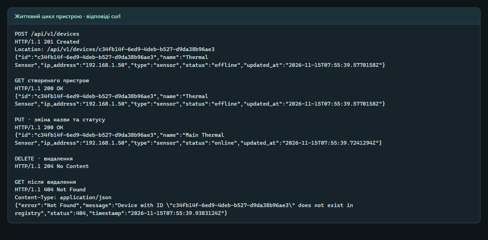

# Практична робота № 4. REST API на Go з маршрутизатором Chi

Device Registry API реєструє мережеві пристрої, повертає список і деталі, оновлює та видаляє записи. Сервіс зберігає дані в пам’яті до перезапуску та повертає відповіді у форматі JSON.

## Запуск

Потрібен Go 1.22 або новіший. У папці проєкту виконай:

```powershell
go mod download
go run .
```

Сервер слухає `127.0.0.1:8080`. Для іншого порту, наприклад `8090`, запусти `go run . -addr 127.0.0.1:8090`. Зупинка сервера через `Ctrl+C`.

## Маршрути

| Метод і шлях | Застосування | Успішна відповідь |
| --- | --- | --- |
| `GET /api/v1/devices` | Список пристроїв. Підтримує `status` і `type`. | `200 OK` і масив. |
| `POST /api/v1/devices` | Створення пристрою. | `201 Created`, об’єкт і заголовок `Location`. |
| `GET /api/v1/devices/{id}` | Дані конкретного пристрою. | `200 OK` і об’єкт. |
| `PUT /api/v1/devices/{id}` | Повна заміна полів наявного пристрою. | `200 OK` і оновлений об’єкт. |
| `DELETE /api/v1/devices/{id}` | Видалення пристрою. | `204 No Content`. |
| `OPTIONS` на цих шляхах | Дозволені методи та CORS preflight. | `204 No Content` із заголовками. |

Для `POST` і `PUT` потрібні `name`, `ip_address` (IPv4 або IPv6) та `type`. Поле `status` приймає `online` або `offline`, типове значення `offline`. Значення `type` і `status` нормалізуються до нижнього регістру. `id` (UUID v4) та `updated_at` (час UTC) встановлює сервер. `PUT` зберігає ідентифікатор і записує новий час модифікації. Фільтри зіставляються одночасно за обома полями. Якщо збігів немає, API повертає `[]`.

Помилки обробників і маршрутизації мають поля `error`, `message`, `status` і `timestamp`. Зокрема, невалідний запит повертає `400`, а звернення до відсутнього пристрою повертає `404`. Максимальний розмір JSON-тіла становить 16 КіБ.

## Перевірка в другому терміналі PowerShell

```powershell
$base = 'http://127.0.0.1:8080/api/v1/devices'
$payload = @{ name='Thermal Sensor'; ip_address='192.168.1.50'; type='sensor'; status='offline' }
$body = $payload | ConvertTo-Json -Compress
$device = $body | curl.exe -sS -X POST $base -H 'Content-Type: application/json' --data-binary '@-' | ConvertFrom-Json
$item = "$base/$($device.id)"

curl.exe -i $item
$payload.name = 'Main Thermal Sensor'
$payload.status = 'online'
$payload | ConvertTo-Json -Compress | curl.exe -i -X PUT $item -H 'Content-Type: application/json' --data-binary '@-'
curl.exe -i "$($base)?status=online&type=sensor"
curl.exe -i -X OPTIONS $item -H 'Origin: https://panel.example' -H 'Access-Control-Request-Method: PUT' -H 'Access-Control-Request-Headers: Content-Type, Authorization'
curl.exe -i -X DELETE $item
curl.exe -i $item
```

Після видалення останній `GET` поверне структуровану помилку `404`. В автоматизованій перевірці 13 запитів `curl` пройшли через локальний TCP-порт. Також успішно виконано `go test -count=3 ./...`, `go vet ./...` і збірку. Тести охоплюють CRUD, валідацію, фільтрацію, `OPTIONS`, формат `405` і відновлення після штучно викликаної паніки.

Зображення нижче сформовано з фактичних відповідей `curl` і журналу сервера.



- [Фільтрація, валідація та CORS](docs/screenshots/filters-cors.png)
- [Журнал сервера з кодами відповідей і тривалістю запитів](docs/screenshots/server-log.png)

## Будова проєкту

- `internal/domain` містить модель пристрою та критерії фільтрації.
- `internal/repository` реалізує `DeviceRepository` на базі карти і `sync.RWMutex`. Читачі отримують копію даних, а оновлення й видалення перевіряють запис під тим самим блокуванням, під яким змінюють карту.
- `internal/handler` збирає дерево маршрутів Chi через `Route`, отримує `id` за допомогою `chi.URLParam`, валідує дані й формує JSON.
- Middleware призначає ID запиту, логує метод, адресу клієнта, шлях, код і тривалість. Recovery записує стек паніки в журнал і повертає `500`, якщо відповідь ще не почалась. CORS дозволяє будь-яке джерело без облікових даних браузера, методи `GET`, `POST`, `PUT`, `DELETE`, `OPTIONS` і заголовки `Content-Type`, `Authorization`.

[Відповіді на контрольні запитання](answers/).
